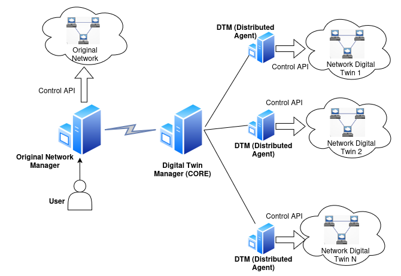
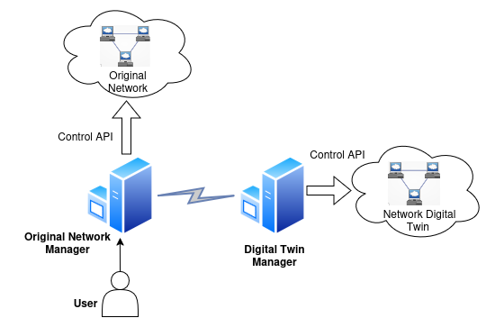

# Federated NDT Framework
This framework is a Proof-of-Concept (PoC) for the federation of multiple Network Digital Twin (NDT) instances, as proposed by Xavier Calle-Heredia and Xavier Hesselbach (UPC). 

The proposed federation of multiple NDTs is a novel topic that is envisioned as 

## Overview
Currently, the framework is provided with two operational configurations: 
- The federated Mode (1:N) (***Under development and testing***): 
    The framework considers an existing network deployed with Mininet technology, defined as Original Network (ON), which emulates a simple existing network. With this framework it is possible to deploy multiple Mininet replicas of the ON. The framework relies in two manager entities: the Original Network Manager (ONM) and the Digital Twin Manager (DTM).

    - The ONM oversees the ON and receives events intended to modify the topology of the ON. Then, forwards the event towards the DTM.
    - The DTM is the main entity of the system and is in charge of the synchronization of the NDTs. The DTM is decompossed in two agents: the DTM Core is a centralized agent that receives and distribute ON events. While the DTM distributed agents are in charge of implementing each ON event into the NDT.
    
- A conventional mode (1:1): this is the currently analyzed configuration in the literature and considers a sinlge NDT instance derived from an ON. This mode will be further analyzed for the inclusion of Extended Reality (XR) services.


## Framework Components
The framework relies in a Kubernetes architecture to support the deployment of each component. Therefore, main components deployed as K8s pods are:
- ONM 
- DTM (core)
- ON
- NDTs (includes two containers: the NDT and the DTM distributed agent)

The ON as well as the NDTs are created from [topology](federated/topology.json) json file. The current topology is shown next:


## Requirements

### Single machine (v1.6 — Kubernetes)
| Component | Version |
|-----------|---------|
| Linux | Ubuntu 24.04 / Linux Mint 22.3 |
| Kubernetes | v1.34+ |
| containerd | v2.1+ |
| Calico CNI | any |
| Docker | 24+ (for building images) |
| Python | 3.10+ |
| Open vSwitch | 3.x |
| Mininet | 2.3+ |

Python dependencies (see `requirements.txt`):
- `orjson` — fast JSON serialization in DTM
- `mininet` — network emulation (inside containers)

---

## Repository Structure
This repository includes the necessary files for supporting the experiments including: python scripts, bash scripts, Dockerfiles and yaml files

```
federated-ndt-framework/
└── federated/
    ├── DTM/
    │   ├── dtm.py                  DTM core + distributed agent
    │   └── Dockerfile
    ├── ONM/
    │   ├── onm.py                  ONM logic + CLI
    │   ├── on_events_gen.py        Automated event injector
    │   ├── onm_commands.txt        Default command set
    │   ├── send_events.sh
    │   └── Dockerfile
    ├── on_ndt_creation/
    │   ├── on_ndt.py               Mininet keeper (ON + NDT roles)
    │   ├── Dockerfile
    │   └── entrypoint_on.sh
    ├── ndt_deployment/
    │   ├── mininet_ndts/
    │   │   ├── Dockerfile
    │   │   ├── entrypoint.sh
    │   │   ├── launch_ndts.sh
    │   │   └── stop_ndts.sh
    │   └── simulated_ndts/
    │       ├── ndt_gen.py          NDT simulator (Exp. 2)
    │       └── Dockerfile
    ├── topology.json               Default 2-LAN topology
    ├── kubernetes/
    │   ├── namespace.yaml
    │   ├── on-pod.yaml             Pod ON + Service svc-on
    │   ├── onm-pod.yaml            Pod ONM (hostNetwork)
    │   ├── dtm-pod.yaml            Pod DTM core (hostNetwork, federated)
    │   ├── dtm-ndt-pod.yaml        Pod DTM+NDT (1:1 mode)
    │   ├── launch_testbed.sh       Full testbed launcher
    │   └── stop_testbed.sh         Full testbed stopper
    └── analysis/
        ├── experiment_1.py
        └── experiment_2.py
```

---

## Topology files
 
Topology files define the Mininet network structure loaded by the ON and all NDTs. They are JSON files with the following format:
 
```json
{
  "description": "2-LAN topology",
  "backbone": {"nat_ip": "10.0.0.254/24"},
  "lans": [
    {"id": 1, "subnet": "192.168.10", "hosts": 2},
    {"id": 2, "subnet": "192.168.20", "hosts": 2}
  ]
}
```
 
The default topology (`federated/topology.json`) is a 2-LAN topology. The ONM image includes two topology files available at runtime:
- `/app/2lan.json` — 2-LAN topology (default, 2 routers, 4 hosts)
- `/app/3lan.json` — 3-LAN topology (3 routers, 6 hosts)
To add more topology files, copy them to `ONM/` before building the image — the Dockerfile copies all `.json` files from that directory into `/app/`.
 
The topology is shared between the ON and all NDTs via a hostPath volume (`/tmp/ndt-run`) mounted at `/run` inside each pod. When the ONM writes a new topology, all pods read it from the same path.
 
---


## Prepare the environment
### 1. Build Docker images and import into containerd
 
```bash
cd federated-ndt-framework/federated
 
docker build -t dtm:1.0         DTM/
docker build -t onm:1.0         ONM/
docker build -t on-mininet:1.0  on_ndt_creation/
docker build -t ndt-mininet:1.0 ndt_deployment/mininet_ndts/
```
 
Then import each image into containerd so Kubernetes can use them:
 
```bash
docker save dtm:1.0         | sudo ctr -n k8s.io images import -
docker save onm:1.0         | sudo ctr -n k8s.io images import -
docker save on-mininet:1.0  | sudo ctr -n k8s.io images import -
docker save ndt-mininet:1.0 | sudo ctr -n k8s.io images import -
```

### 2. Verify images

```bash
sudo crictl images | grep -E "dtm|onm|mininet"
```

## Running the Testbed

### Federated mode (1:N)

```bash
cd federated/kubernetes

# Launch testbed with N=2 NDTs
./launch_testbed.sh --mode federated --fanout 2

# Check all pods are Running
kubectl get pods -n ndt
```

Expected pods:
```
ndt-1     2/2     Running   (ndt + dtm-agent)
ndt-2     2/2     Running   (ndt + dtm-agent)
pod-dtm   1/1     Running   
pod-on    1/1     Running   
pod-onm   1/1     Running   
```

You can check containers in each NDT:
```bash
kubectl get pod ndt-1 -n ndt -o jsonpath='{range .spec.containers[*]}{.name}{"\t"}{.image}{"\n"}{end}'
```

Expected containers:
```
ndt	        ndt-mininet:1.0   -> NDT running with mininet
dtm-agent	dtm:1.0           -> DTM distributed agent
```

To start the experiment, you need to run the ONM:
```bash
kubectl exec -it pod-onm -n ndt -- python3 onm.py \
    --proto udp --relay-ip 127.0.0.1 \
    --relay-port 7001 --relay-kind router \
    --on-ip 10.233.85.156 \
    --log-file /tmp/onm.log
```

You can use multiple windows to oversee the ON and each NDT and execute them:
```bash
# Original network:
kubectl exec -it pod-on -n ndt -- bash
```

```bash
# NDT 1:
kubectl exec -it ndt-1 -n ndt -- bash
```

```bash
# NDT 2:
kubectl exec -it ndt-2 -n ndt -- bash
```

In the ON and NDTs pods you can check connectivity between r1 and r2 routers
```bash
mnexec -a $(pgrep -f "mininet:r1") ping -c 3 10.0.0.22
PING 10.0.0.2 (10.0.0.2) 56(84) bytes of data.
64 bytes from 10.0.0.2: icmp_seq=1 ttl=64 time=2.41 ms
64 bytes from 10.0.0.2: icmp_seq=2 ttl=64 time=0.664 ms
64 bytes from 10.0.0.2: icmp_seq=3 ttl=64 time=0.064 ms
```

Then, in the ONM pod you can disable the link just by introducing the comand in the CLI:
```bash
> set r1 r2 down 0 0 1000
[ONM] Applied locally and sent to DTM
> 
```

Chcek again in the ON and NDTs pods the r1-r2 connectivity:
```bash
mnexec -a $(pgrep -f "mininet:r1") ping -c 3 10.0.0.22
ping: connect: Network is unreachable
```

You can restart the link in the ONM:
```bash
> set r1 r2 down 0 0 1000
[ONM] Applied locally and sent to DTM
> 
```

In the ON and NDTs pods you can check connectivity between r1 and r2 routers
```bash
mnexec -a $(pgrep -f "mininet:r1") ping -c 3 10.0.0.22
PING 10.0.0.2 (10.0.0.2) 56(84) bytes of data.
64 bytes from 10.0.0.2: icmp_seq=1 ttl=64 time=2.41 ms
64 bytes from 10.0.0.2: icmp_seq=2 ttl=64 time=0.664 ms
64 bytes from 10.0.0.2: icmp_seq=3 ttl=64 time=0.064 ms
```

## Dynamic Topology Change
 
The ONM supports changing the network topology at runtime without restarting the testbed. When a new topology is applied, the ON and all NDTs reload Mininet with the new configuration simultaneously.
 
### How it works
 
1. The ONM writes the new topology to `/run/topology_config.json` (shared hostPath volume).
2. The ONM sends a `RELOAD` command to the ON via the control API.
3. The ONM sends a `TOPOLOGY_UPDATE` event to the DTM core.
4. The DTM core forwards the `TOPOLOGY_UPDATE` to each NDT's distributed agent.
5. Each DTM agent writes the new topology to `/run/topology_config.json` and sends a `RELOAD` to its local NDT.
6. All Mininet instances restart with the new topology.
### Topology files in the ONM pod
 
The ONM image includes two topology files at `/app/`:
- `/app/2lan.json` — 2-LAN topology (default)
- `/app/3lan.json` — 3-LAN topology
To add a custom topology permanently, copy the JSON file to `ONM/` and rebuild the image:
 
```bash
cp my_topology.json federated/ONM/
docker build -t onm:1.0 federated/ONM/
docker save onm:1.0 | sudo ctr -n k8s.io images import -
```
 
### Applying a topology change
 
In the ONM CLI:
```
> topology /app/3lan.json
[ONM] New topology saved to /run/topology_config.json
[ONM] ON Mininet reloading...
[ONM] ON reload complete (3 LANs ready)
[ONM] TOPOLOGY_UPDATE sent to DTM (3 LANs)
[ONM] Graph reloaded: 14 nodes
```
 
To revert to 2 LANs:
```
> topology /app/2lan.json
```
 
### Verifying the topology change
 
After applying a new topology, verify that the ON and all NDTs reloaded correctly:
 
```bash
# ON — should show 3 LANs
kubectl logs pod-on -n ndt --since=2m | grep -E "TOPO|LAN"
 
# NDT-1 — should show 3 LANs
kubectl logs ndt-1 -n ndt -c ndt --since=2m | grep -E "TOPO|LAN"
 
# NDT-2 — should show 3 LANs
kubectl logs ndt-2 -n ndt -c ndt --since=2m | grep -E "TOPO|LAN"
```
 
Expected output for each:
```
*** [TOPO] Loaded /run/topology_config.json — 3 LANs, 6 hosts
*** LAN 1: 192.168.10.x, 2 hosts
*** LAN 2: 192.168.20.x, 2 hosts
*** LAN 3: 192.168.30.x, 2 hosts
*** [TOPO] Exported topology to /run/topology.json
```
 
To verify connectivity in the new LAN 3 (from inside the ON or any NDT pod):
```bash
mnexec -a $(pgrep -f "mininet:h3_1") ping -c 3 8.8.8.8
PING 8.8.8.8 (8.8.8.8) 56(84) bytes of data.
64 bytes from 8.8.8.8: icmp_seq=1 ttl=113 time=15.2 ms
64 bytes from 8.8.8.8: icmp_seq=2 ttl=113 time=10.9 ms
64 bytes from 8.8.8.8: icmp_seq=3 ttl=113 time=11.4 ms
```

---

## Experiment 1 — Synchronization Metrics vs Federation Size
 
Experiment 1 measures two metrics as a function of the number of NDTs (N):
 
- **L_dispatch** — time for the DTM to fan out one event to all N NDTs (ms)
- **T_conv** — convergence spread: difference between the first and last NDT to apply the event (ms)
Both metrics are reported as mean ± 95% confidence interval across 5 runs.
 
### Running the automated experiment
 
The script `run_experiment1.sh` fully automates the experiment. For each value of N in `{1, 2, 4, 8, 16, 32, 64}` it launches the testbed, injects events via `on_events_gen.py`, collects the DTM log, and stops the testbed. This is repeated 5 times.
 
```bash
cd federated/kubernetes
./run_experiment1.sh
```
 
By default the experiment uses `rate=0.5 ev/s` and `duration=60s` per run (30 events per run). To use more events for more robust statistics:
 
```bash
./run_experiment1.sh --runs 5 --rate 2 --duration 120 --out /tmp/exp1
```
 
| Argument | Default | Description |
|----------|---------|-------------|
| `--runs` | 5 | Number of runs per N value |
| `--rate` | 0.5 | Event injection rate (ev/s) |
| `--duration` | 60 | Duration per run (seconds) |
| `--out` | `/tmp/exp1` | Output directory for logs |
 
The estimated total duration with defaults is approximately 75–90 minutes (35 testbed launches × ~100–150s each). For a quick validation run before the full experiment:
 
```bash
./run_experiment1.sh --runs 1 --duration 20
```
 
Results are saved with the following structure:
```
/tmp/exp1/
  run1/
    1to1/dtm.log
    1to2/dtm.log
    1to4/dtm.log
    1to8/dtm.log
    1to16/dtm.log
    1to32/dtm.log
    1to64/dtm.log
  run2/
    ...
  run5/
    ...
```
 
### Analysing the results
 
Once all runs are complete, run the analysis script. To run the script, some python packages are required within a venv.
 
```bash
python3 -m venv venv 
source venv/bin/activate
pip install numpy pandas matplotlib scipy tabulate 
 
python3 federated/analysis/experiment_1.py \
    --logs /tmp/exp1 \
    --out  /tmp/exp1/results
```
 
