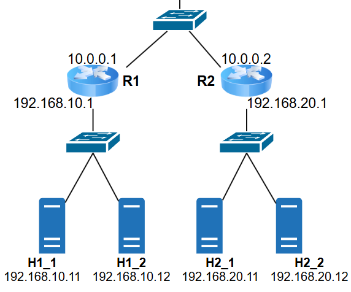
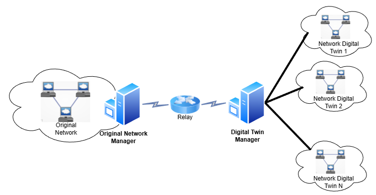
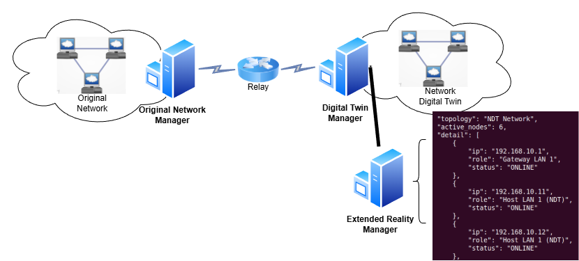

# Federated NDT Framework
This framework is implemented to function as a Proof-of-Concept (PoC) for a novel conceptualization of Network Digital Ttwins (NDTs), which is the federation of multiple NDT instances, as proposed by both authors: Xavier Calle-Heredia and Xavier Hesselbach.

## Overview
The framework considers an existing network deployed with Mininet technology, defined as Original Network (ON), which emulates a simple existing network. With this framework it is possible to deploy multiple Mininet replicas of the ON. By means of a centralized manager entity, defined as the Digital Twin Manager, it is possible to coordinate the N NDT replicas deployed. 

To deploy the ON as well as the NDT replicas, a python script is used. This script creates a simple Mininet network containing 2 LANs as it can be appreciated next:


In addition to the main DTM, the PoC relies in a complementary entuty named as Original Network Manager (ONM). The ONM allows to introduce network modifications to the ON; after apply those modifications, the ONM forwards the same modification command to the DTM in order to achieve synchronization between the ON and the N NDTs. Next, an overview of the PoC can be seen:
 

In this current version, the framework runs in two different computers. Our current conditions are:
- ***PC1*** (Windows laptop) hosts three Virtual Machines (VMs) to support the ONM, DTM and a router node to emulate a communication channel between both managers. All VMs use Linux Mint 22.3.
- On the other hand, ***PC2*** supports the deployment of the N NDTs based on Docker containers. This PC uses Linux Mint 22.3.
It is important to guarantee that both PCs are conencted to same network to facilitate the communication between VMs and containers. 

***Note:*** In this current version, the ON as well as the N NDTs are required to be run sepparately, i.e. In ***PC1*** on the corresponding ON VM, as well as in ***PC2***.


## Preparing the environment

### PC1:
Let's start with the configuration of Virtual Machines in PC1. Three independent VMs are required with next networking configuration:

    1. VM ON
        - Bridge: enp0s3
        - Internal Network (ON) enp0s8: 172.16.1.2/30

    2. VM DTM
        Bridge: enp0s3
        Internal Network(DT) enp0s8: 172.16.2.2/30
        Internal Network(s8s) enp0s8: 192.168.99.X -> OPTIONAL: For future XR services integration based on Kubernetes

    3 Relay: VM router
        Bridge: enp0s3
        Internal Network (ON) enp0s8: 172.16.1.1/30
        Internal Network (DT) enp0s9: 172.16.2.1/30  

For configuring the VMs, follow this tutorial: [config_guide](federated/VBox_VMs_config/configuration.md)

It is recommended to create a dedicated directory in each VM:
```bash
mkdir /home/ubuntu/federated
```

Then, copy the scripts to each VM:

1. VM ON:
   - [ONM files](federated/ONM/)
   - [ON-NDT deployment](federated/on_ndt_creation)

2. VM DTM:
   - [DTM](federated/DTM)
   - [ON-NDT deployment](federated/on_ndt_creation)

3. VM Router:
    - [Router](federated/relay)

### PC2:
Following the installation in PC2. Docker must be installed. In case Docker is missing you can install it as follows:
```bash
sudo apt update
sudo apt install -y ca-certificates curl
sudo install -m 0755 -d /etc/apt/keyrings
sudo curl -fsSL https://download.docker.com/linux/ubuntu/gpg \
    -o /etc/apt/keyrings/docker.asc
sudo chmod a+r /etc/apt/keyrings/docker.asc

echo "deb [arch=$(dpkg --print-architecture) \
    signed-by=/etc/apt/keyrings/docker.asc] \
    https://download.docker.com/linux/ubuntu noble stable" | \
    sudo tee /etc/apt/sources.list.d/docker.list

sudo apt update
sudo apt install -y docker-ce docker-ce-cli containerd.io
sudo usermod -aG docker $USER
newgrp docker
```

It is recommended to create a dedicated directory:
```bash
mkdir /home/ubuntu/federated
```

In this directory, you can copy these files: [mininet-NDTs](federated/ndt_deployment/mininet_ndts). This directory contains the Dockerfile to create the image with mininet and all required components that is invoked to create each NDT container. In addition, it is required to copy the script to launch the mininet network: [on-ndt-deployment](federated/on_ndt_creation/on_ndt.py). Finally, the Docker image can be built:
```bash
docker build -t ndt-mininet .
```

## Running the Testbed
After completing the set-up process, the testbed is ready to run. We have thought in two experiments. 
- Experiment 1 (Ready to test): Intended to test the synchronization from the ON to the N NDTs. Therefore, the ONM will receive a modification command, the ONM will apply this in the ON mininet and after that i will forward the modification to the DTM which will forward the command and apply it to the NDTs.
- Experiment 2 (Under development): Intended to demonstrate the DTM coordination whn receiving updates from the NDTs and requires to arrange them to forward them properly to the ONM.

Therefore, ww will focus just in Experiment 1. The order to run the experiment is:
### 1. Run the N NDTs (PC2):
```bash
./launch_ndts.sh <number of NDTs> <DTMs IP Address> <listening port> udp <ACK port> 
# For instantce:
./launch_ndts.sh 8 10.4.47.53 8001 udp 9000
# Wait until all NDTs are ready.
# You can check with:
docker ps
```

### 2. Run the router VM
```bash
python3 relay.py --proto udp --port 7001
```

### 3. Run the ON (PC1-VM ON)
```bash
sudo python3 on_ndt.py --role on
```

### 4. Run the DTM (PC1-VM DTM)
```bash
python3 dtm.py \
    --proto udp \
    --relay-ip 172.16.2.1 \
    --relay-port 7001 \
    --mode federated \
    --fanout <Number of NDTs> \
    --dst-ip <PC2 ip address> \
    --base-port <NDTs listenning port> \
    --feedback-port <ACKs receiving port> \
    --experiment-duration <Duration time in seconds> \
    --log-file /home/ubuntu/exp1/run1/1to1/dtm.log

# For instance:
python3 dtm.py \
    --proto udp \
    --relay-ip 172.16.2.1 \
    --relay-port 7001 \
    --mode federated \
    --fanout 1 \
    --dst-ip 10.4.47.50 \
    --base-port 8001 \
    --feedback-port 9000 \
    --experiment-duration 150 \
    --log-file /home/ubuntu/exp1/run1/1to1/dtm.log
```

### 5. Run the ONM (PC1-VM ON)
The ONM can be run as follows:
```bash
python3 onm.py \
    --proto udp \
    --relay-ip 172.16.1.1 \
    --relay-port 7001 \
    --relay-kind router
```

Then, you can manually introduce a command from [ON-commands](federated/ONM/onm_commands.txt) (Just copy and paste). 

In order to automate the experiment, we have prepared a script to automatically send the commands each 2 seconds (a safe time to allow each NDT to apply the modification). Therefore, we recommend to run the ONM like this:
```bash
./send_events.sh | python3 onm.py \
    --proto udp \
    --relay-ip 172.16.1.1 \
    --relay-port 7001 \
    --relay-kind router
```

You can check that the synchronization is actually working (Running the ON in manual mode, i.e. without send_events.sh). To do so, you can send an ON command and then access to any NDT container as follows:
```bash
# In VM ON in ONM console down the link between r1 and r2 nodes:
set r1 r2 down 0 0 1000

# in PC2:
mnexec -a $(pgrep -f "mininet:r1") ping r2
# you should notice that r2 is unreachable from r1. 
# You can bring the link up again from the ONM and re-test.
```


# NDT-PoC

This is a PoC for testing Event-driven synchronization between ON-NDT

## Architecture:

    1. VM ON
        Puente: enp0s3: 192.168.1.98/24 
        Red interna (ON) enp0s8: 172.16.1.2/30

    2. VM NDT
        Puente: enp0s3: 192.168.1.124/24 
        Red interna (DT) enp0s8: 172.16.2.2/30
        Red interna (K8S) enp0s9: 192.168.99.X

    3. VM K8S
        Puente: enp0s3: 192.168.1.123/24 
        Red interna (K8S) enp0s8: 192.168.99.2/30

    4. Communication channel
        COmmunication channel in two modalities with both TCP/UDP:

        4.1 Relay: VM router
            Puente: enp0s3: 192.168.1.125/24 
            Red interna (ON) enp0s8: 172.16.1.1/30
            Red interna (DT) enp0s9: 172.16.2.1/30  

The architecture including mininet ON and NDT is seen below:


## Running the PoC:
Before running the PoC it is required to enable the performance mode in the host laptop:
```bash
powercfg /setactive 8c5e7fda-e8bf-4a96-9a85-a6e23a8c635c
```

Deactivate the mode when experiment is over:
```bash
powercfg /setactive 381b4222-f694-41f0-9685-ff5bb260df2e
```


The PoC can run under two different execution modes: normal (1:1) and federated (1:N). 

- 1:1 Mode: In this operation mode, the ONM is used as the input interface to modify the ON mininet with actions such a: "set r1 r2 down 0 0 1000", "set r1 r2 up 50 1 10", "exec r1 "ip route add 10.20.30.40 via 10.0.0.254"", "exec r1 "ip route del 10.20.30.40 via 10.0.0.254"". The ONM applies these modifications in the ON and then transmits the command to the DTM vis the relay node. The DTM receives the ON modification and applies locally the modification (the NDT mininet need to run).

- 1:N Mode: in this mode, the ONM operates as in the 1:1; however, the DTM, doesn't require the NDT mininet running. Therefore, the DTM just forwards the ON commands to N NDTs while it receives and coordinates the NDT's generated events to transmit them coordinated to the ONM.


Initiate the ON
### VM ON:
```bash
sudo python3 on_ndt.py --role on
```

Initiate the NDT
### VM NDT
```bash
sudo python3 on_ndt.py --role ndt
```

Initiate the relay:
```bash
python3 relay.py --proto tcp --port 7001
```

## Start the Experiments
### ONM
To autoamte the ONM commands execution there are two supporting files: on_events_gen.py and onm_commands.txt.
Arguments: 
- file: contains the ON commands.
- rate: rate in ev/second.
- duration: experiment duration in seconds.
- monck-on: flag to avoid the execution of the events in the ON
- log-file: path where a supporting log is saved (optional)

```bash
python3 on_events_gen.py --file onm_commands.txt --rate <rate: events per second> --duration <experiment time> | python3 onm.py --proto tcp --relay-ip 172.16.1.1 --relay-port 7001 --relay-kind vps  --mock-on  --log-file /home/ubuntu/final_test/2core/1to64_tcp/onm.log
```

### DTM:
- 1:1 Mode:


```bash
python3 dtm.py --proto tcp --relay-ip 172.16.2.1 --relay-port 7001 --mode 1:1 --log-file /home/ubuntu/dtm_events.log -experiment-duration 75
```

- 1:N Mode:


To further gather the metrics, it is recommended next folder structure for saving experiments, where 1toN it is the suggested name of the folder which stores the DTM log and N is the number of NDTs deployed:

- losses/
    - run1/
        - 1to1/
            - dtm.log
        - 1to5/
            - dtm.log
        - 1to10/
        - 1to20/
    - run2/
        - 1to1/
        - 1to20/
    - run3/
    - run4/
    - run5/

```bash
python3 dtm.py --proto tcp  --relay-ip 172.16.2.1  --relay-port 7001  --mode federated  --fanout 15  --dst-ip 192.168.99.2  --base-port 8001  --feedback-port 9000  --group-size 1  --wave-delay 0  --max-queue 30  --experiment-duration 75  --disable-priorities  --log-file /home/ubuntu/final_test/experiment2/losses/1to15/dtm.log
```

Arguments:
  - mode: 1:1/federated
  - fanout (federated mode): Number of fan out NDTs
  - dst-ip (federated mode): IP address of the VM that deploys and generates NDT events.
  - base-port (federated mode): port used by the DTM to transmit the ON events to the NDTs.
  - feedback-port (federated mode): port used by the DTM to listen to the NDT events.
  - group size (federated mode-optional): used to forward events to the NDTs in groups.
  - wave-delay (federated mode-optional): delay between transmission groups.
  - max-queue (federated mode-optional): size of the queue handled by the DTM, if no size is proved the queue is unlimited.
  - experiment-duration: duration of the experiment in seconds.
  - disable-priorities (federated mode-optional): if it is turned on the events are discarded equally when the queue is full; if is turned off the critical events are forwarded while non-critical events might be discarded.

### NDTs and generator:
Generate mode
- Uniform

```bash
python3 ndt_gen.py --mode generate --fanout 15 --feedback-ip 192.168.99.1 --feedback-port 9000 --priority-mode paper_mix --rate 3000 -arrival-mode uniform --duration 60 --start-delay 5
```

- Poisson

```bash
python3 ndt_gen.py --mode generate --fanout 15 --feedback-ip 192.168.99.1 --feedback-port 9000 --priority-mode paper_mix --rate 3000 -arrival-mode poisson --duration 60 --start-delay 5
```

### Get metrics:
```bash
python3 experiment_2.py --logs /home/ubuntu/final_test/experiment2/losses/ --out  /home/ubuntu/final_test/results/losses/ --C 2000
```
