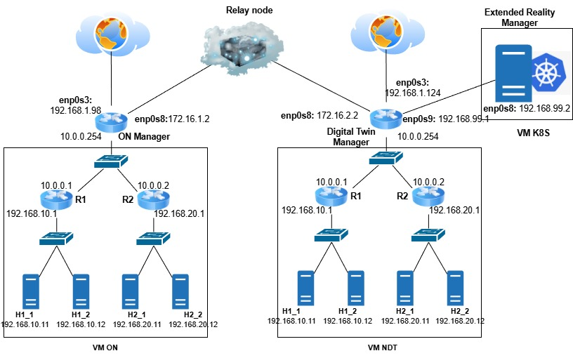

# NDT-PoC

This is a PoC for testing Event-driven synchronization between ON-NDT

## Architecture:

    1. VM ON
        Puente: enp0s3: 192.168.1.98/24 
        Red interna (ON) enp0s8: 172.16.1.2/30

    2. VM NDT
        Puente: enp0s3: 192.168.1.124/24 
        Red interna (DT) enp0s8: 172.16.2.2/30
        Red interna (K8S) enp0s9: 192.168.99.X

    3. VM K8S
        Puente: enp0s3: 192.168.1.123/24 
        Red interna (K8S) enp0s8: 192.168.99.2/30

    4. Communication channel
        COmmunication channel in two modalities with both TCP/UDP:

        4.1 Relay: VM router
            Puente: enp0s3: 192.168.1.125/24 
            Red interna (ON) enp0s8: 172.16.1.1/30
            Red interna (DT) enp0s9: 172.16.2.1/30  

The architecture including mininet ON and NDT is seen below:


## Running the PoC:
Before running the PoC it is required to enable the performance mode in the host laptop:
```bash
powercfg /setactive 8c5e7fda-e8bf-4a96-9a85-a6e23a8c635c
```

Deactivate the mode when experiment is over:
```bash
powercfg /setactive 381b4222-f694-41f0-9685-ff5bb260df2e
```


The PoC can run under two different execution modes: normal (1:1) and federated (1:N). 

- 1:1 Mode: In this operation mode, the ONM is used as the input interface to modify the ON mininet with actions such a: "set r1 r2 down 0 0 1000", "set r1 r2 up 50 1 10", "exec r1 "ip route add 10.20.30.40 via 10.0.0.254"", "exec r1 "ip route del 10.20.30.40 via 10.0.0.254"". The ONM applies these modifications in the ON and then transmits the command to the DTM vis the relay node. The DTM receives the ON modification and applies locally the modification (the NDT mininet need to run).

- 1:N Mode: in this mode, the ONM operates as in the 1:1; however, the DTM, doesn't require the NDT mininet running. Therefore, the DTM just forwards the ON commands to N NDTs while it receives and coordinates the NDT's generated events to transmit them coordinated to the ONM.


Initiate the ON
### VM ON:
```bash
sudo python3 on_ndt.py --role on
```

Initiate the NDT
### VM NDT
```bash
sudo python3 on_ndt.py --role ndt
```

Initiate the relay:
```bash
python3 relay.py --proto tcp --port 7001
```

## Start the Experiments
### ONM
To autoamte the ONM commands execution there are two supporting files: on_events_gen.py and onm_commands.txt.
Arguments: 
- file: contains the ON commands.
- rate: rate in ev/second.
- duration: experiment duration in seconds.
- monck-on: flag to avoid the execution of the events in the ON
- log-file: path where a supporting log is saved (optional)

```bash
python3 on_events_gen.py --file onm_commands.txt --rate <rate: events per second> --duration <experiment time> | python3 onm.py --proto tcp --relay-ip 172.16.1.1 --relay-port 7001 --relay-kind vps  --mock-on  --log-file /home/ubuntu/final_test/2core/1to64_tcp/onm.log
```

### DTM:
- 1:1 Mode:


```bash
python3 dtm.py --proto tcp --relay-ip 172.16.2.1 --relay-port 7001 --mode 1:1 --log-file /home/ubuntu/dtm_events.log -experiment-duration 75
```

- 1:N Mode:


```bash
python3 dtm.py --proto tcp  --relay-ip 172.16.2.1  --relay-port 7001  --mode federated  --fanout 15  --dst-ip 192.168.99.2  --base-port 8001  --feedback-port 9000  --group-size 1  --wave-delay 0  --max-queue 30  --experiment-duration 75  --disable-priorities  --log-file /home/ubuntu/final_test/experiment2/losses/1to15/dtm.log
```

Arguments:
  - mode: 1:1/federated
  - fanout (federated mode): Number of fan out NDTs
  - dst-ip (federated mode): IP address of the VM that deploys and generates NDT events.
  - base-port (federated mode): port used by the DTM to transmit the ON events to the NDTs.
  - feedback-port (federated mode): port used by the DTM to listen to the NDT events.
  - group size (federated mode-optional): used to forward events to the NDTs in groups.
  - wave-delay (federated mode-optional): delay between transmission groups.
  - max-queue (federated mode-optional): size of the queue handled by the DTM, if no size is proved the queue is unlimited.
  - experiment-duration: duration of the experiment in seconds.
  - disable-priorities (federated mode-optional): if it is turned on the events are discarded equally when the queue is full; if is turned off the critical events are forwarded while non-critical events might be discarded.

### NDTs and generator:
Generate mode
```bash
python3 ndt_gen_ev.py --mode generate --fanout 15 --feedback-ip 192.168.99.1 --feedback-port 9000 --priority-mode paper_mix --rate 3000 --duration 60 --start-delay 5
```

### Get metrics:
To get the metrics, it is recommended next folder structure:

- losses/
    - run1/
        - 1to1/
            - dtm.log
        - 1to5/
            - dtm.log
        - 1to10/
        - 1to20/
    - run2/
        - 1to1/
        - 1to20/
    - run3/
    - run4/
    - run5/

```bash
python3 experiment_2.py --logs /home/ubuntu/final_test/experiment2/losses/ --out  /home/ubuntu/final_test/results/losses/ --C 2000
```
