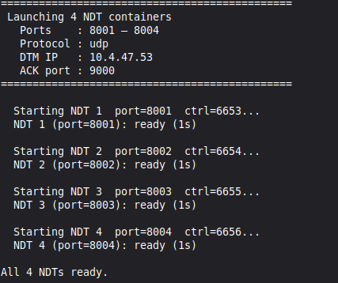
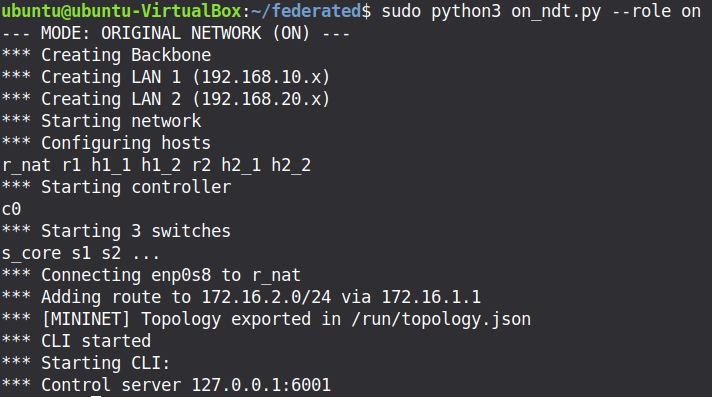
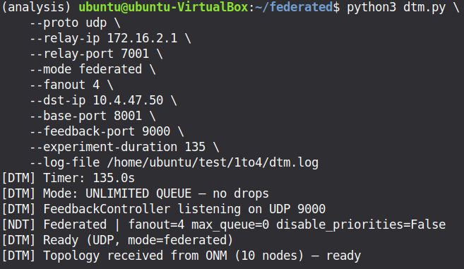
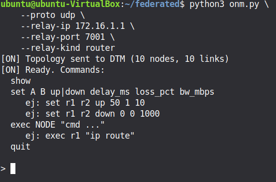
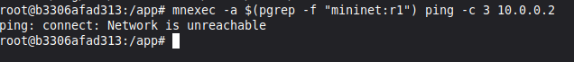

# Federated NDT Framework
This framework is a Proof-of-Concept (PoC) for the federation of multiple Network Digital Twin (NDT) instances, as proposed by Xavier Calle-Heredia and Xavier Hesselbach (UPC). 

The proposed federation of multiple NDTs is a novel topic that is envisioned as 

## Overview
Currently, the framework is provided with two operational configurations: 
- The federated Mode (1:N) (***Under development and testing***): 
    The framework considers an existing network deployed with Mininet technology, defined as Original Network (ON), which emulates a simple existing network. With this framework it is possible to deploy multiple Mininet replicas of the ON. The framework relies in two manager entities: the Original Network Manager (ONM) and the Digital Twin Manager (DTM).

    - The ONM oversees the ON and receives events intended to modify the topology of the ON. Then, forwards the event towards the DTM.
    - The DTM is the main entity of the system and is in charge of the synchronization of the NDTs. The DTM is decompossed in two agents: the DTM Core is a centralized agent that receives and distribute ON events. While the DTM distributed agents are in charge of implementing each ON event into the NDT.
    
- A conventional mode (1:1): this is the currently analyzed configuration in the literature and considers a sinlge NDT instance derived from an ON. This mode will be further analyzed for the inclusion of Extended Reality (XR) services.


## Framework Components
The framework relies in a Kubernetes architecture to support the deployment of each component. Therefore, main components deployed as K8s pods are:
- ONM 
- DTM (core)
- ON
- NDTs (includes two containers: the NDT and the DTM distributed agent)

The ON as well as the NDTs are created from [topology](federated/topology.json) json file. The current topology is shown next:


## Requirements

### Single machine (v1.6 — Kubernetes)
| Component | Version |
|-----------|---------|
| Linux | Ubuntu 24.04 / Linux Mint 22.3 |
| Kubernetes | v1.34+ |
| containerd | v2.1+ |
| Calico CNI | any |
| Docker | 24+ (for building images) |
| Python | 3.10+ |
| Open vSwitch | 3.x |
| Mininet | 2.3+ |

Python dependencies (see `requirements.txt`):
- `orjson` — fast JSON serialization in DTM
- `mininet` — network emulation (inside containers)

---

## Repository Structure
This repository includes the necessary files for supporting the experiments including: python scripts, bash scripts, Dockerfiles and yaml files

```
federated-ndt-framework/
└── federated/
    ├── DTM/
    │   ├── dtm.py                  DTM core + distributed agent
    │   └── Dockerfile
    ├── ONM/
    │   ├── onm.py                  ONM logic + CLI
    │   ├── on_events_gen.py        Automated event injector
    │   ├── onm_commands.txt        Default command set
    │   ├── send_events.sh
    │   └── Dockerfile
    ├── on_ndt_creation/
    │   ├── on_ndt.py               Mininet keeper (ON + NDT roles)
    │   ├── Dockerfile
    │   └── entrypoint_on.sh
    ├── ndt_deployment/
    │   ├── mininet_ndts/
    │   │   ├── Dockerfile
    │   │   ├── entrypoint.sh
    │   │   ├── launch_ndts.sh
    │   │   └── stop_ndts.sh
    │   └── simulated_ndts/
    │       ├── ndt_gen.py          NDT simulator (Exp. 2)
    │       └── Dockerfile
    ├── topology.json               Default 2-LAN topology
    ├── kubernetes/
    │   ├── namespace.yaml
    │   ├── on-pod.yaml             Pod ON + Service svc-on
    │   ├── onm-pod.yaml            Pod ONM (hostNetwork)
    │   ├── dtm-pod.yaml            Pod DTM core (hostNetwork, federated)
    │   ├── dtm-ndt-pod.yaml        Pod DTM+NDT (1:1 mode)
    │   ├── launch_testbed.sh       Full testbed launcher
    │   └── stop_testbed.sh         Full testbed stopper
    └── analysis/
        ├── experiment_1.py
        └── experiment_2.py
```

---


## Prepare the environment
### 1. Build Docker images directly into containerd
Using `nerdctl` builds images directly into the Kubernetes namespace
```bash
cd federated-ndt-framework/federated

sudo nerdctl --namespace k8s.io build -t dtm:1.0         DTM/
sudo nerdctl --namespace k8s.io build -t onm:1.0         ONM/
sudo nerdctl --namespace k8s.io build -t on-mininet:1.0  on_ndt_creation/
sudo nerdctl --namespace k8s.io build -t ndt-mininet:1.0 ndt_deployment/mininet_ndts/
```
### 2. Verify images

```bash
sudo crictl images | grep -E "dtm|onm|mininet"
```

## Running the Testbed

### Federated mode (1:N)

```bash
cd federated/kubernetes

# Launch testbed with N=2 NDTs
./launch_testbed.sh --mode federated --fanout 2

# Check all pods are Running
kubectl get pods -n ndt
```

Expected pods:
```
pod-on        1/1   Running
pod-onm       1/1   Running
pod-dtm       1/1   Running
exp1-ndt-1    2/2   Running   (ndt + dtm-agent)
exp1-ndt-2    2/2   Running   (ndt + dtm-agent)
```

The script prints the ONM command at the end with the correct `svc-on` IP:

```bash
kubectl exec -it pod-onm -n ndt -- python3 onm.py \
    --proto udp --relay-ip 127.0.0.1 \
    --relay-port 7001 --relay-kind router \
    --on-ip <SVC_ON_IP> \
    --log-file /tmp/onm.log
```


## Running the Testbed
After completing the set-up process, the testbed is ready to run. We have thought in two experiments. 
- Experiment 1 (Ready to test): Intended to test the synchronization from the ON to the N NDTs. Therefore, the ONM will receive a modification command, the ONM will apply this in the ON mininet and after that i will forward the modification to the DTM which will forward the command and apply it to the NDTs.
- Experiment 2 (***Under development***): Intended to demonstrate the DTM coordination whn receiving updates from the NDTs and requires to arrange them to forward them properly to the ONM.

Therefore, we will focus just in Experiment 1. The order to run the experiment is:
### 1. Run the N NDTs (PC2):
```bash
./launch_ndts.sh <number of NDTs> <DTMs IP Address> <listening port> udp <ACK port> 
# For instantce:
./launch_ndts.sh 8 10.4.47.53 8001 udp 9000
# Wait until all NDTs are ready.
# You can check with:
docker ps
```


### 2. Run the router VM
```bash
python3 relay.py --proto udp --port 7001
```

### 3. Run the ON (PC1-VM ON)
```bash
sudo python3 on_ndt.py --role on
```


### 4. Run the DTM (PC1-VM DTM)
Before running, it is required to install some python dependencies to properly run the DTM and then, gather the latency metrics. 
Before running the DTM for the first time you can create a virtual environment and install dependecies:
```bash
chmod +x install_dependencies.sh 
./install_dependencies.sh 
```

Once the script has concluded the virtual environment is ready and you can start the DTM. If you want to use the DTM again, you just need to activate the virtual environment:
```bash
source venv/bin/activate
```

```bash
python3 dtm.py \
    --proto udp \
    --relay-ip 172.16.2.1 \
    --relay-port 7001 \
    --mode federated \
    --fanout <Number of NDTs> \
    --dst-ip <PC2 ip address> \
    --base-port <NDTs listenning port> \
    --feedback-port <ACKs receiving port> \
    --experiment-duration <Duration time in seconds> \
    --log-file /home/ubuntu/exp1/run1/1to1/dtm.log

# For instance:
python3 dtm.py \
    --proto udp \
    --relay-ip 172.16.2.1 \
    --relay-port 7001 \
    --mode federated \
    --fanout 1 \
    --dst-ip 10.4.47.50 \
    --base-port 8001 \
    --feedback-port 9000 \
    --experiment-duration 150 \
    --log-file /home/ubuntu/exp1/run1/1to1/dtm.log
```


We recommend to save dtm log files in an appropriate folde structure similar as the one shown next where 1toX will store the dtm log of the experiment with X NDTs deployed. This will facilitate gathering the federation metrics.

- exp1/
    - run1/
        - 1to1/
            - dtm.log
        - 1to8/
            - dtm.log
        - 1to16/
        - 1to64/
    - run2/
        - 1to1/
        - 1to64/
    - run3/
    - run4/
    - run5/

### 5. Run the ONM (PC1-VM ON)
The ONM can be run as follows:
```bash
python3 onm.py \
    --proto udp \
    --relay-ip 172.16.1.1 \
    --relay-port 7001 \
    --relay-kind router
```



Then, you can manually introduce a command from [ON-commands](federated/ONM/onm_commands.txt) (Just copy and paste). 

In order to automate the experiment, we have prepared a script to automatically send the commands each 2 seconds (a safe time to allow each NDT to apply the modification). Therefore, we recommend to run the ONM like this:
```bash
./send_events.sh | python3 onm.py \
    --proto udp \
    --relay-ip 172.16.1.1 \
    --relay-port 7001 \
    --relay-kind router
```

You can check that the synchronization is actually working (Running the ON in manual mode, i.e. without send_events.sh). To do so, you can send an ON command and then access to any NDT container as follows:
```bash
# In VM ON in ONM console down the link between r1 and r2 nodes:
set r1 r2 down 0 0 1000

# in PC2:
mnexec -a $(pgrep -f "mininet:r1") ping 10.0.0.2
# you should notice that r2 is unreachable from r1. 
# You can bring the link up again from the ONM and re-test.
```



### Gather metrics
Metrics that can be retrieved are related with the synchronization latencies due to federation. To gather the metrics use the script [exp-1-analysis](federated/analysis/experiment_1.py):
```bash
python3 experiment_1.py \
    --logs /home/ubuntu/exp1/ \
    --out  /home/ubuntu/exp1/results/
```

## License
This project is licensed under the GNU General Public License v3.0.
See the [LICENSE](LICENSE) file for details.

# What is comming in the future?
## Further Implementation of Experiment 2 (***Under development and testing***) and Experiment 3 (XR integration):

## Set the host laptop in high efficiency mode:
```bash
# ON
powercfg /setactive 8c5e7fda-e8bf-4a96-9a85-a6e23a8c635c
# off
powercfg /setactive 381b4222-f694-41f0-9685-ff5bb260df2e
```

## Start the Experiments
### ONM
To autoamte the ONM commands execution there are two supporting files: on_events_gen.py and onm_commands.txt.
Arguments: 
- file: contains the ON commands.
- rate: rate in ev/second.
- duration: experiment duration in seconds.
- monck-on: flag to avoid the execution of the events in the ON
- log-file: path where a supporting log is saved (optional)

```bash
python3 on_events_gen.py --file onm_commands.txt --rate <rate: events per second> --duration <experiment time> | python3 onm.py --proto tcp --relay-ip 172.16.1.1 --relay-port 7001 --relay-kind vps  --mock-on  --log-file /home/ubuntu/final_test/2core/1to64_tcp/onm.log
```

### DTM:
- 1:1 Mode:

```bash
python3 dtm.py --proto tcp --relay-ip 172.16.2.1 --relay-port 7001 --mode 1:1 --log-file /home/ubuntu/dtm_events.log -experiment-duration 75
```

- 1:N Mode:

To further gather the metrics, it is recommended next folder structure for saving experiments, where 1toN it is the suggested name of the folder which stores the DTM log and N is the number of NDTs deployed:

- losses/
    - run1/
        - 1to1/
            - dtm.log
        - 1to5/
            - dtm.log
        - 1to10/
        - 1to20/
    - run2/
        - 1to1/
        - 1to20/
    - run3/
    - run4/
    - run5/

```bash
python3 dtm.py --proto tcp  --relay-ip 172.16.2.1  --relay-port 7001  --mode federated  --fanout 15  --dst-ip 192.168.99.2  --base-port 8001  --feedback-port 9000  --group-size 1  --wave-delay 0  --max-queue 30  --experiment-duration 75  --disable-priorities  --log-file /home/ubuntu/final_test/experiment2/losses/1to15/dtm.log
```

Arguments:
  - mode: 1:1/federated
  - fanout (federated mode): Number of fan out NDTs
  - dst-ip (federated mode): IP address of the VM that deploys and generates NDT events.
  - base-port (federated mode): port used by the DTM to transmit the ON events to the NDTs.
  - feedback-port (federated mode): port used by the DTM to listen to the NDT events.
  - group size (federated mode-optional): used to forward events to the NDTs in groups.
  - wave-delay (federated mode-optional): delay between transmission groups.
  - max-queue (federated mode-optional): size of the queue handled by the DTM, if no size is proved the queue is unlimited.
  - experiment-duration: duration of the experiment in seconds.
  - disable-priorities (federated mode-optional): if it is turned on the events are discarded equally when the queue is full; if is turned off the critical events are forwarded while non-critical events might be discarded.

### NDTs and generator:
Generate mode
- Uniform

```bash
python3 ndt_gen.py --mode generate --fanout 15 --feedback-ip 192.168.99.1 --feedback-port 9000 --priority-mode paper_mix --rate 3000 -arrival-mode uniform --duration 60 --start-delay 5
```

- Poisson

```bash
python3 ndt_gen.py --mode generate --fanout 15 --feedback-ip 192.168.99.1 --feedback-port 9000 --priority-mode paper_mix --rate 3000 -arrival-mode poisson --duration 60 --start-delay 5
```

### Get metrics:
```bash
python3 experiment_2.py --logs /home/ubuntu/final_test/experiment2/losses/ --out  /home/ubuntu/final_test/results/losses/ --C 2000
```
